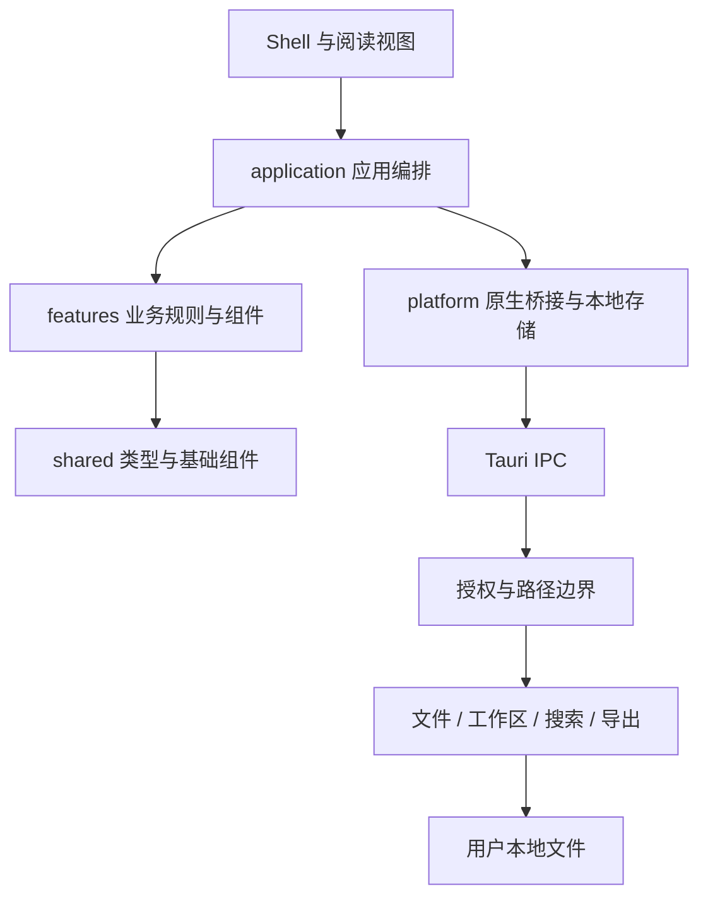

# 架构与决策

## 职责关系

`App.tsx` 组合布局；`useReaderApplication` 按固定顺序连接业务 hooks；`useReaderState` 创建唯一一套会话状态与引用。每个业务 hook 通过类型化 `Pick<ReturnType<...>>` 声明输入，不能另建一套文档真源。视图通过 `Pick<ReaderApplication,...>` 限定所需状态与操作。

## 前端模块

| 模块                                              | 责任                                 | 不应承担              |
| ------------------------------------------------- | ------------------------------------ | --------------------- |
| application/useDocumentSession                    | 打开、解析、保存、冲突协调           | 具体按钮排版          |
| application/useWorkspaceSession                   | 挂载、扫描、差量刷新、切换缓存       | Markdown 解析细节     |
| application/useWorkspaceActions                   | 工作区文件操作与结果同步             | 绕过原生授权          |
| application/useEditing、useEditorHistory          | 草稿变更、编辑模式、恢复、历史       | 原文件保存算法        |
| application/useDocumentExport、useWorkspaceExport | 当前文档/批量导出编排                | HTML 清洗实现         |
| application/useSettingsPersistence                | 偏好恢复、保存队列、关闭时刷新       | 文档内容保存          |
| application/useOpenEvents、useDocumentTabs        | 启动/拖放/快捷键事件、标签生命周期   | 渲染器内部状态        |
| features/documents                                | 格式识别、解析、清洗、统计与目录     | 桌面 UI               |
| features/reader                                   | 目录、阅读位置、分段渲染、阅读布局   | 文件授权              |
| features/editor                                   | CodeMirror/Milkdown 交互及语义保护   | 私有持久化格式        |
| features/workspace                                | 搜索/筛选/关联/树形结构              | 应用根状态            |
| features/recovery                                 | 外部变更、草稿、确认对话框           | 自动覆盖本地文件      |
| platform                                          | Tauri bridge、存储、更新、路径规范化 | 应用视图与 React 编排 |
| shell、shared                                     | 操作入口、可复用组件、类型           | 隐式读写磁盘          |

hooks 拆分保留原事件顺序；依赖数组显式列出从状态模块传入的引用与 setter，避免抽取后依赖隐含。解析器、索引器和文件安全逻辑保留原测试。

## 桌面模块

`commands/mod.rs` 提供模型、缓存容器和内部公共定义。子模块只在命令层内共享实现，前端看到的 32 个 IPC 命令名称保持稳定。

| 文件         | 职责                                       |
| ------------ | ------------------------------------------ |
| access.rs    | 读/写授权、路径归一化、范围判断            |
| dialogs.rs   | 原生选择、启动参数、历史路径重新授权       |
| files.rs     | 编码检测、读取、文件元数据、临时写入与替换 |
| workspace.rs | 文件类型、递归目录、文件清单               |
| watcher.rs   | 原生监听、事件合并所需通知与缓存失效       |
| search.rs    | 有界文本缓存、倒排索引、持久缓存、线性回退 |
| index.rs     | 标题、标签、链接提取与差量索引             |
| entries.rs   | 新建、复制、重命名、删除和文件管理器定位   |
| settings.rs  | 原生设置文件与关闭窗口                     |
| pdf.rs       | Windows Edge PDF 渲染与结果校验            |
| tests.rs     | 原有跨模块安全与行为测试                   |

## 数据流

打开文档：用户选择 → 原生授权登记 → 读取文本/二进制 → 适配器识别格式并清洗 → 建立文档快照 → 显示阅读视图 → 持久化有限的最近记录。

编辑保存：明确进入编辑 → 更新 `sourceDraft` 与历史 → 阅读预览重新渲染 → 保存前检查外部修改 → 原生临时文件写入与替换 → 清除脏标记与对应草稿。

资料库刷新：原生 watcher 事件 → 前端合并变更路径 → Rust 返回文件和索引差量 → 更新树、搜索与关联 → 当前文档若有未保存内容则提示冲突。

## 设计决策

### 保留技术栈和文件格式

继续使用 React 18、TypeScript、Vite、Tauri 2、Rust、Milkdown 和 CodeMirror，锁文件固定依赖版本；新增 YAML 解析器用于可保留注释和未知字段的属性编辑。阅读器仍以普通文件为真源，不增加云服务或集中状态库。第二阶段的独立 AI 空间使用 SQLite 与 MCP，共享内核及数据边界见 [AI 架构](AI-ARCHITECTURE.md)。

### 阅读优先

Markdown 默认直接编辑，不可无损表达的结构使用源码；TXT 为纯文本，DOCX/PDF 以阅读为主。Ctrl+E 切换阅读与编辑。内容、草稿、保存队列由文档会话管理；标签、焦点和位置由窗格管理，见 ADR 0001。

### 独立开发身份

桌面标识为 `com.moyang.reader.next`。开发期不继承正式更新源和文件关联，避免覆盖已安装产品。IPC 命令和持久化设置格式兼容，用户可主动导入设置。

### 渐进式职责拆分

文档会话、窗格、阅读资料库和 AI 草稿均有独立状态所有者。两个窗格打开同一文件时复用内容与保存队列，分别保留视图；平台接口承接所有原生操作。

## 参考与后续约束

[React 自定义 Hooks 文档](https://react.dev/learn/reusing-logic-with-custom-hooks)说明 hooks 抽取复用逻辑，不会自动共享状态；因此本工程只创建一次会话状态。[Tauri capabilities 文档](https://v2.tauri.app/security/capabilities/)用于核对权限配置边界；运行时路径授权仍由 Rust 显式执行。

新增功能必须定义目录归属、状态所有者、存储行为与验证方式。`features` 不导入 `application` 或 `shell`；`platform` 不导入应用编排。业务 UI 不直接调用 Tauri `invoke`，统一经过桥接层。
